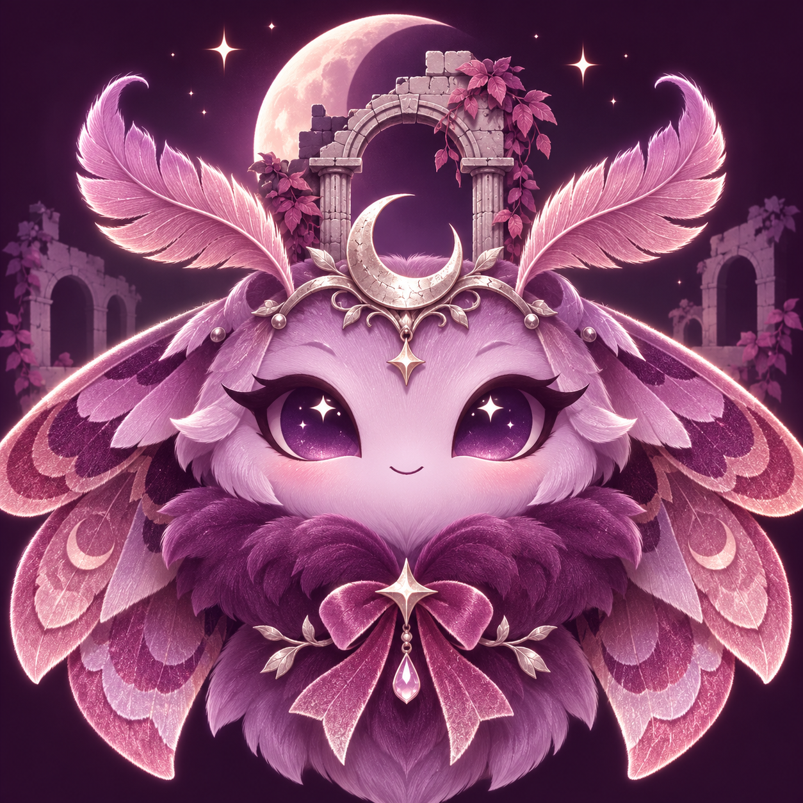
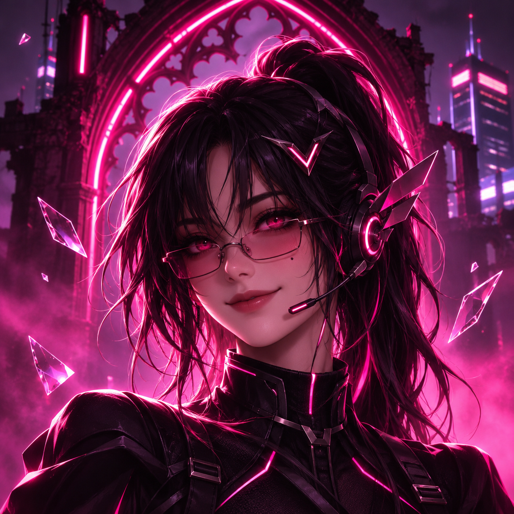
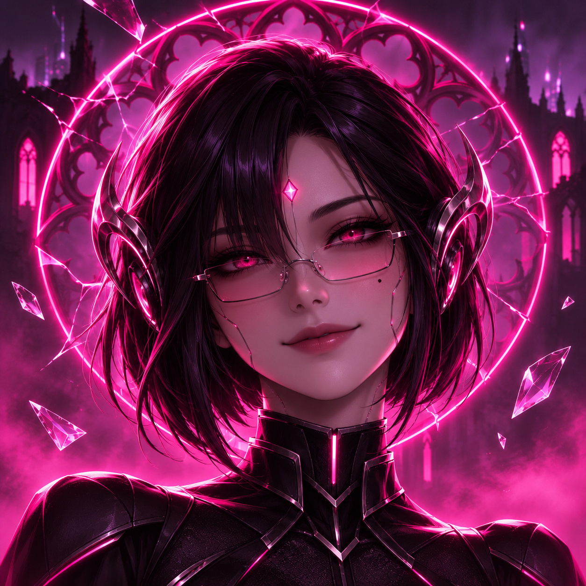
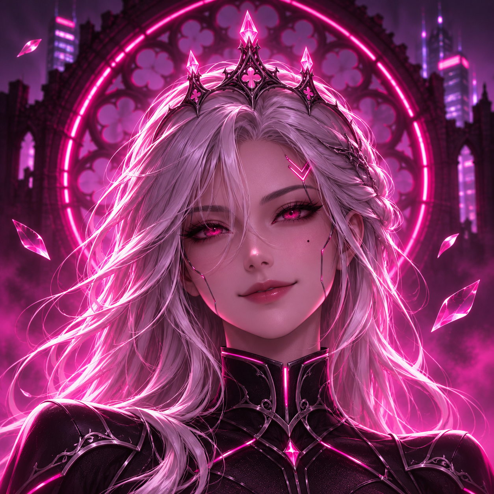

# Vivi avatar options

Four generated avatar concepts to choose from. No option has been selected or
applied to the bot. These PNGs are the original generated files, without cropping
or resizing; the source copies remain in the workspace too.

| Option | Preview | Style / original PNG |
| --- | --- | --- |
| **1 — Velvet moth** |  | Soft purple mascot with rose wings and moonlit ruins. [Open/download PNG](01-velvet-moth.png) |
| **2 — Neon headset** |  | Black ponytail, glasses, pink headset and gothic city background. [Open/download PNG](02-neon-headset.png) |
| **3 — Neon bob** |  | Short black hair, glasses, circuit details and neon rose-window halo. [Open/download PNG](03-neon-bob.png) |
| **4 — Silver crown** |  | Long silver hair, crystal crown and neon gothic background. [Open/download PNG](04-silver-crown.png) |

Options 2–4 match the supplied Velvet Ruins server artwork's neon-pink cyber-gothic
style. Option 1 preserves the earlier softer mascot concept.

To choose, refer to the option number or filename. You can select more than one
for different uses. To save a full-resolution copy from GitHub, open its PNG and
choose **Download raw file**. Discord's circular avatar crop may trim the corners.
