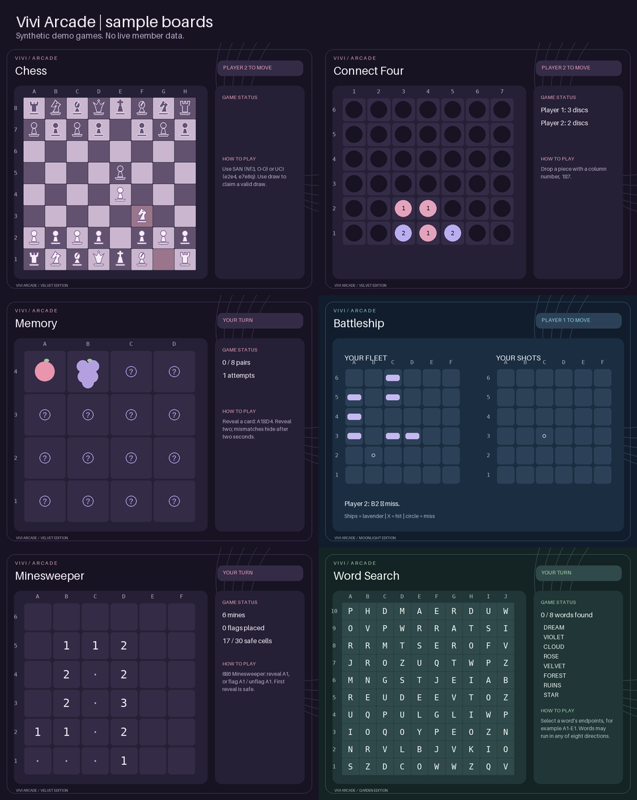

# Vivi Arcade design update

Existing games now use locally rendered PNG cards with dark plum panels, rose and
lavender accents, clear coordinates and a consistent status/instruction layout.
Chess pieces and memory symbols use original drawing primitives; no external image
service or paid AI provider is required. Fonts are bundled for Windows/Linux/Docker.

These screenshots contain generated demonstration games, not live member data.
Recreate them with `python scripts/preview_games.py`.

## Controls and themes

- `/games theme theme:velvet`, `moonlight` or `garden` saves your arcade colors.
  The host’s preference controls public cards. Changing it updates their active
  game; a participant’s own preference applies to their private board image.
- `/games board` shows your current board privately as an image.
- `/games board format:text` provides the text board and instructions for screen
  readers or anyone preferring text. Trivia also includes its question and choices
  as ordinary embed text.
- Connect Four has column buttons; full columns are disabled.
- Memory has coordinate buttons that reveal matching illustrated symbols.
- Tic-tac-toe has coordinate buttons, disabled occupied squares and the same arcade
  presentation. The opponent now accepts before play, using the shared game session
  controls. Existing winner achievements remain; no extra currency reward was added.
- Reversi offers menus of currently legal moves, alongside the coordinate modal.
- Minesweeper and Battleship offer a row selector that opens private column buttons.
  Minesweeper also provides Reveal/Flag/Unflag modes. These quick controls expire
  after two minutes; reopen them from the main board when needed.
- The move modal shows game-specific examples, including chess notation, checkers
  jumps, Sudoku entries and crossword answers.
- Resign uses a clearly marked destructive button; challenges have Accept/Decline
  controls. Completed or expired shared game cards remove active controls.

Anagram rounds display their round number and deadline. Correct guesses and
unrevealed round scores remain private until the next round or final standings.
Trivia answers gain success/error colors after selection. The older solo word
scramble has a matching card while retaining `/games guess` and its existing rules.

## Private information and Discord behavior

Before rendering, Vivi constructs a presentation-only snapshot. Unshot enemy ship
locations, hidden memory faces, unrevealed mines, Sudoku solutions and hidden word
answers are excluded. The renderer never receives the full engine object.

Public Battleship cards show the latest shot/status and decorative waves. Only a
participant’s ephemeral board includes their fleet and their own shot grid; it does
not reveal unshot enemy ships. Quick move controls are bound to the requesting
member and game session. Old game controls cannot operate a replacement session.

Game images need **Attach Files** and **Embed Links** in the playing channel, along
with normal message permissions. If Discord rejects the image or local rendering
assets are unavailable, shared game sessions can fall back to their text boards.
Private image requests also retain a text fallback. Individual images replace the
old attachment on updates rather than accumulating every previous board.

Images are generated in worker threads from snapshots. Updates for each game are
serialized so a slower render cannot overwrite a later completed update. Images
are not stored in the database or included in member profiles; existing puzzle
save/resume behavior is unchanged.

## Important remaining work

These are recommendations, not newly implemented features:

1. **Live Discord checks:** verify image/embed permissions, challenge buttons,
   ephemeral fleets, DMs and OAuth with your actual server. Offline mocks and image
   tests cannot establish that the deployed configuration works.
2. **Built-in scheduled encrypted full-data backups and off-site copies:** the bot’s
   scheduled backups currently cover configuration. The encrypted full-data CLI
   exists and can already be scheduled externally, but built-in scheduling, off-site
   copies and routine recovery drills would make recovery easier.
3. **Member data exports and configurable retention:** deletion requests exist;
   self-service exports and automatic age-based cleanup of retained records/files
   are still missing.
4. **More game persistence:** crossword, word-search, Minesweeper and spelling
   progress are saved. Multiplayer games and Sudoku still end on process restart.
5. **More question/puzzle content:** the current crossword and spelling collections
   are deliberately small. Additional reviewed packs would improve replay value.
6. **Optional AI budget caps:** daily request limits exist, but provider spending
   budgets would add another control if you decide to enable paid AI.

For continuous availability, the host PC must remain awake and online. Automatic
restart/startup does not keep Vivi online while the machine sleeps or loses power.

## Games worth adding next

| Game | Why it fits |
| --- | --- |
| UNO-style card game | Social multiplayer with private hands and a shared discard pile. |
| 2048 | Quick solo puzzle with simple directional controls. |
| Mastermind | Small logic game with colored guesses and clear feedback. |
| Dots and Boxes | Short turn-based matches that work well with button controls. |
| Codenames-style word teams | Party activity that puts the new team tools to use. |
| Dice scorecard game | Casual rounds with reroll controls and visible score sheets. |

These games have not been added by this design update.

## Verification

Automated checks cover rendered image sizes, portable fonts, theme differences,
redaction of hidden state, private controls, component limits, attachment replacement,
text fallbacks, stale sessions and existing tic-tac-toe rewards. The existing full
suite and dashboard DOM tests remain applicable. Docker smoke tests render cards
without network access or a Discord token. Actual Discord appearance and accessibility
still need a live check with your chosen client and server configuration.
