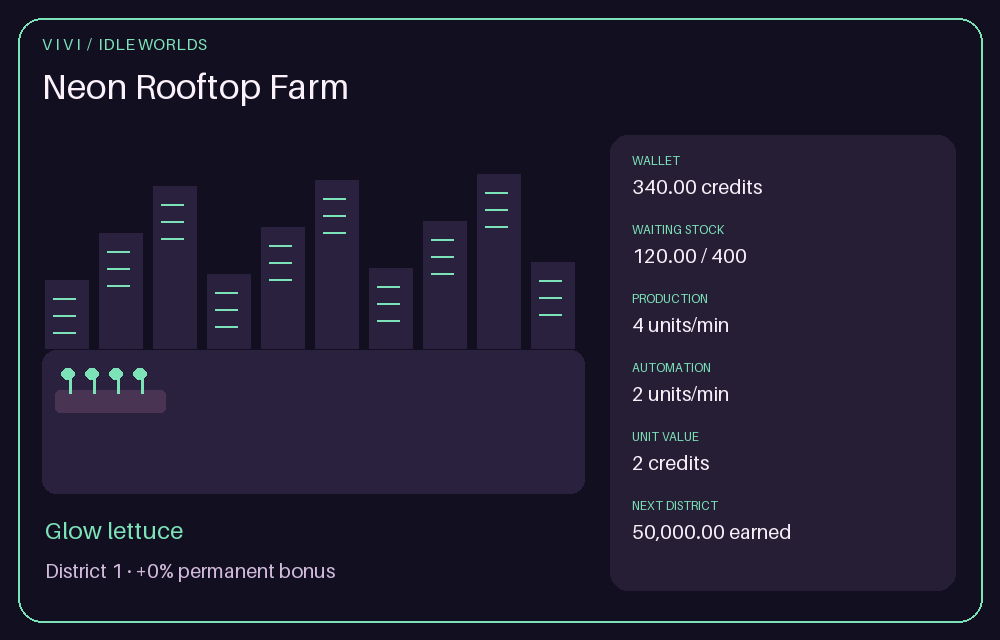
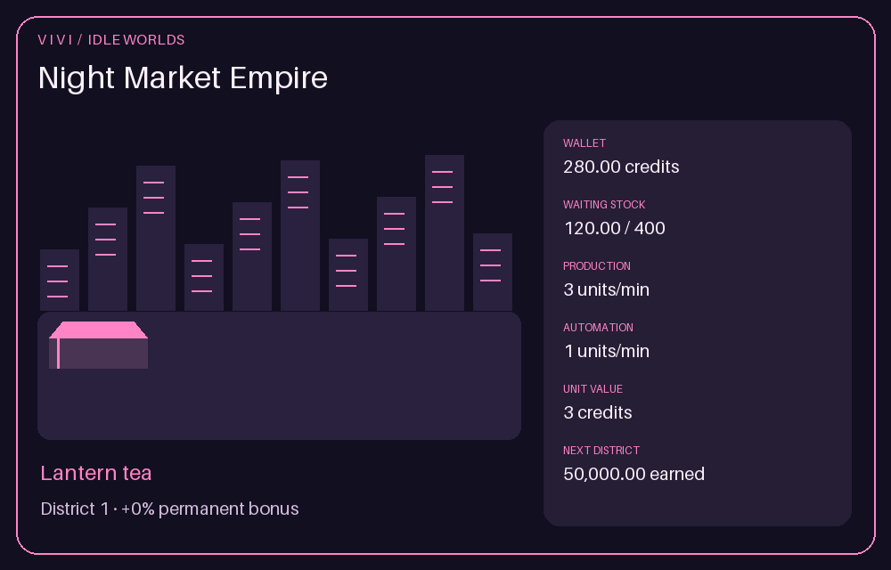

# Vivi idle worlds

**Neon Rooftop Farm** and **Night Market Empire** are persistent games with private
profiles. Enable `/admin feature name:games enabled:true`, then open:

- `/idle farm` — grow neon crops, add rooftop plots, research varieties and upgrade
  delivery drones that automatically sell produce.
- `/idle market` — expand supernatural market stalls, hire night staff, unlock new
  merchant goods and serve customers automatically.

Both start with 100 fictional credits, one production building and one automatic
worker. Each game has its own wallet, inventory, upgrades, lifetime earnings and
district number. Credits never connect to Vivi's economy coins or card-game chips;
there are no purchases, transfers, betting or real-money payouts.

## Playing

Use the private card's buttons:

- **Refresh** calculates progress and redraws your profile.
- **Sell waiting stock** sells all currently stored produce/orders immediately.
- **Add plots / Add stalls** increases production.
- **Delivery drones / Hire staff** increases automatic selling capacity.
- **Expand storage** increases the waiting-stock limit.
- **Research crops / New merchants** unlocks the next crop/product tier and improves
  production per building and the selling price.
- **New district** opens a reset confirmation when you're ready for a new cycle.

Upgrade prices grow with level. Buildings, automation and storage have 100 levels
per district; research has six product tiers including the starting tier. Buttons
last 15 minutes. Run the slash command again after they expire or the bot restarts.
Old buttons cannot silently buy an upgrade at a changed price. Game profiles are
private and controls belong to their owner and server.

## Offline progress

Progress is calculated from the last saved server timestamp whenever you open or
interact with a game. No constant Discord messages or per-player timers are needed.
The bot can be stopped: when it returns, elapsed time is credited on your next visit.
It must be running to accept commands and show the results.

Each visit credits at most **24 hours** of elapsed production and automatic sales.
Waiting stock has finite capacity; overflow is discarded. Automation continues
selling at its rate even when storage would otherwise fill. Starting capacity is
400 units and each storage level adds another 400. Farm production starts at four
crates/minute, with drones selling two/minute for two credits per crate. Market
production starts at three orders/minute, with staff serving one/minute for three
credits per order. Production and worker upgrades change future rates.

The wallet already includes automatic earnings when the card opens; selling stock
is an additional manual action. Repeated refreshes do not claim the same interval
again. Fractional production and credits use integer accounting.

## District progression

The first new district requires 50,000 lifetime earned credits. Later milestones
are 100,000, 150,000, and so on. Confirming resets that game's wallet to 100 credits,
stock to zero, and buildings/research to starting levels. Lifetime earnings remain.
Each new district adds **25 percentage points** to the permanent production and
worker-rate bonus. Reset confirmations are owner-bound and cannot be reused for
another district.

Profiles survive normal restarts and are separate for each member and server.
They live inside member profiles, so confirmed `/tools delete_data` removes them
from the relevant server's active database. Configuration-only backups exclude
personal game profiles; use the existing full-data backup tools for recovery.

