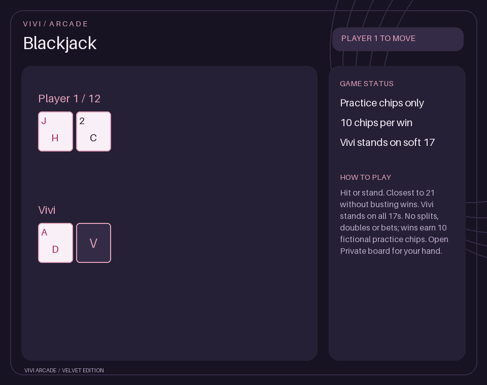
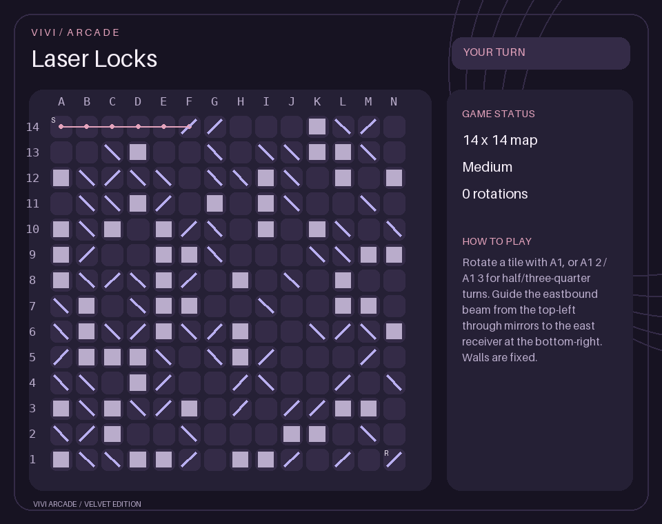

# Cards and procedural puzzles

Enable `/admin feature name:games enabled:true`. These games share Vivi's arcade
sessions, private boards, three color themes and text accessibility mode.

## Card games

- `/cards blackjack` starts a practice hand against Vivi. Add `opponent:@member`
  for a consent-based head-to-head challenge. Hit or stand; aces adjust between
  1 and 11, busting loses, equal valid totals push. Vivi stands on all 17s,
  including soft 17. This simplified practice variant has no splits, doubles,
  insurance, special natural-blackjack payout or bets.
- `/cards go_fish` plays Vivi, or add `opponent:@member`. Ask for a rank you hold
  using **Enter move** or `/games move notation:A`. A successful ask or a matching
  draw keeps the turn. Four of a rank becomes a book; most books wins.
- `/cards profile` privately displays your saved plays, wins and practice chips.
  Each win awards 10 chips. Chips have no real-money value; no purchases,
  transfers, wagering or connection to Vivi's economy coins are provided.

Selecting Vivi explicitly as the opponent also works. Other bots, yourself and
members already in a game cannot be challenged. Human opponents must accept
within two minutes. No reward is given for declined, resigned or expired games.

**Private hand** reveals only your hand, and **Hit / Stand** provide Blackjack
shortcuts. `/games board format:text` is a private text alternative. Active Go Fish
hands are never public. Blackjack hands are revealed when the hand ends; before
then, only your private hand and Vivi's single dealer upcard are visible.

Card sessions end on restart or inactivity; profile statistics persist in the
server's database. They are included in the member profile removed by confirmed
`/tools delete_data`. Each server maintains separate statistics.

## Generated puzzle maps

- `/puzzles pipe_connector` — connect the top-left west inlet to the bottom-right
  east outlet before the water-arrival countdown expires. The countdown continues
  while you are away, including while the bot is offline.
- `/puzzles circuit_repair` — rotate wiring until every tile is powered from the
  top-left source, with every wire end correctly connected. No time limit.
- `/puzzles laser_locks` — rotate mirrors to send a beam from the top-left to the
  east receiver at the bottom-right. Empty cells and walls remain fixed. No time limit.

All three accept `difficulty:easy|medium|hard` and `size:small|medium|large`:

| Map | Dimensions | Tiles |
| --- | --- | --- |
| Small | 6 × 6 | 36 |
| Medium | 10 × 10 | 100 |
| Large | 14 × 14 | 196 |

Difficulty controls scrambling; Laser Locks also varies distracting walls.
Pipe Connector's countdown is 10, 7 or 5 minutes on small maps for easy, medium
and hard, scaled by map area for larger sizes. Circuit Repair uses generated
spanning-tree wiring; pipes and lasers use generated routes with distracting tiles.
Solutions exist by construction. New boards use fresh random seeds, but finite
boards can repeat; this is replayable generation rather than a guarantee of
infinite unique maps.

Rotate through `/games move notation:A1`; use `A1 2` or `A1 3` for multiple quarter
turns. A row dropdown opens private buttons for every column, including N on
large maps. Columns run left to right, rows bottom to top; top-left on a large
map is **A14**. **S** marks the source and **R** the receiver. Powered wiring and
the current laser path are highlighted.

Progress is saved after each move. `/games resume kind:pipe_connector` (or another
puzzle kind) restores it after restarting. Starting that kind again resumes its
existing board, preserving its original size, difficulty and water deadline.
For a fresh board, resign if active, then `/games puzzle_reset kind:pipe_connector`
and start again with your chosen settings. Finished or timed-out pipe boards are
removed from saved progress. Session inactivity ends the live message after
30 minutes, but unfinished puzzle progress remains available to resume.

## Development

`python scripts/preview_new_arcade.py` renders synthetic previews of all five
games into `docs/assets`. Rules and hidden-state presentation have automated
tests; live Discord interactions require your running bot and permissions.
New command groups avoid Discord's 25-child limit on the existing `/games` group.
