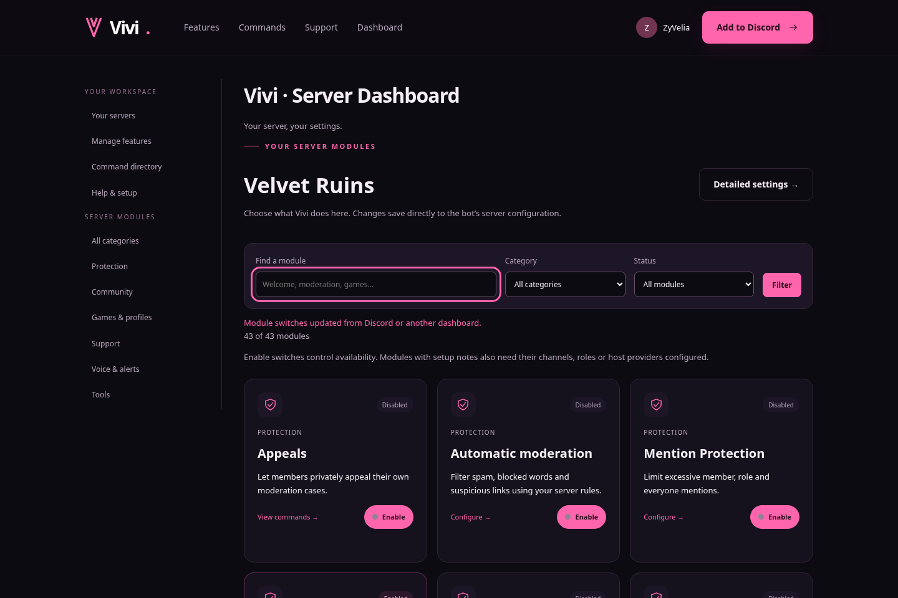

# Manage Vivi features from the website

1. Open Vivi's running website and choose **Sign in with Discord**.
2. Choose **Features → Manage your server’s features**, or **Manage features** in
   the dashboard sidebar.
3. Select a server you own or administer where Vivi is installed. Servers without
   Vivi have an invite button.
4. Browse module cards, search by name, or filter by category and enabled status.
5. Choose **Enable / Disable**. The switch saves without a page reload and shows a
   confirmation only after the server accepts it.
6. Choose **Configure** to open that module's supported detailed settings. Modules
   without server-wide configuration offer their command directory instead.

The feature manager is at `/modules`, with `/modules?guild=YOUR_SERVER_ID` for a
specific server. Existing detailed settings remain at `/dashboard?guild=...`.

This uses the same per-server feature switches as `/settings` and `/admin feature`.
Open module pages check for changes every 30 seconds and when returning to the tab.
Changes from Discord or another dashboard update the switches without reloading.
Feature switches do not replace required channel, role, permission or host setup;
module cards explain relevant dependencies. AI still needs its configured provider
and approved channels. Image filtering still needs reference images.

Current Discord owner/Administrator permissions, installation checks and CSRF
protection are required for every write. No settings are changed by public feature
pages, module searches or GET requests. A failed save retains the previous switch
state and displays an error. Login return paths are limited to known local pages.
Native forms still work if JavaScript is unavailable.

For local hosting, enable `DASHBOARD_ENABLED=true` and run Vivi, then open
`http://127.0.0.1:8765`. Discord login needs the application's OAuth credentials and
registered callback. See [website setup](WEBSITE.md). Public access from other
computers requires the HTTPS hosting setup described there.

